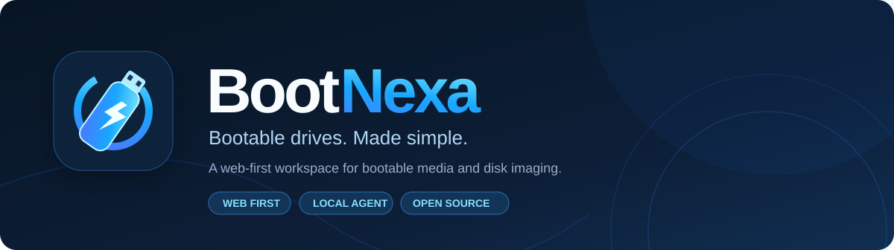
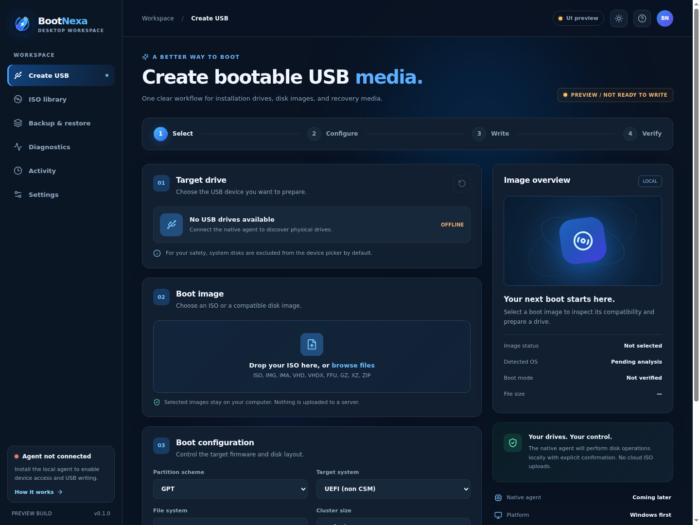

<div align="center">



<br />

[](https://github.com/heidi-dang/bootnexa/actions/workflows/web.yml)
[](LICENSE)


**A better workspace for creating bootable media.**

[Explore the roadmap](doc/ROADMAP.md) · [Architecture](doc/ARCHITECTURE.md) · [Security](doc/SECURITY.md) · [Feature ledger](doc/FEATURE_MATRIX.md) · [0.2 acceptance](doc/ACCEPTANCE-0.2.md) · [Windows installer & signing](doc/WINDOWS-INSTALLER.md) · [Code signing policy](doc/CODE-SIGNING-POLICY.md) · [Privacy](doc/PRIVACY.md)

</div>

---

## Meet BootNexa

BootNexa is an open-source, web-first bootable-media utility designed around a simple idea: preparing a USB installer should be clear, verifiable, and safe.

The browser provides the interface. A local native agent will handle privileged device discovery, imaging, partitioning, and verification directly on the user's machine. No cloud ISO upload. No remote storage of drive contents. No guesswork about whether an image was actually written.

The project takes inspiration from established utilities such as [Rufus](https://rufus.ie/) while pursuing a modern interface and a distinct, capability-driven architecture.

> [!IMPORTANT]
> **Current stage: interactive UI + read-only native-agent source, not a disk-writing application.** The repository includes a Windows Rust agent for local discovery, a native consent prompt and read-only disk inventory, plus in-browser ISO/raw-image structure inspection and SHA-256 integrity checks. A per-user Windows installer and code-signing/release workflow are implemented; no trusted production signing certificate is configured, so no publicly trusted installer has been released. Physical Windows hardware qualification remains outstanding. BootNexa cannot partition, erase, format, flash, verify, or boot-test a drive. The **Start writing** action is intentionally disabled until that work is complete.

## A first look

<div align="center">
  
  <br />
  <sub>Actual screenshot from the running BootNexa development app, captured 20 October 2026. Preview state: agent offline; no devices accessed.</sub>
</div>

The layout is designed for quick decisions without hiding advanced controls: target selection, boot image, partition scheme, firmware mode, filesystem, verification preferences, and operation status all live within one workflow.

### Product pillars

| | |
| --- | --- |
| **Web-first** | Responsive interface with dark and light themes, keyboard-friendly controls, and a focused workflow. |
| **Local by design** | Physical disk operations will run on the user's computer through a signed native agent. |
| **Safety before speed** | Disk identity checks, operating-system-disk exclusion, explicit erase approval, durable job state, and read-back verification. |
| **Transparent operations** | Versioned capabilities, actionable error codes, honest progress, resumable event views, and clear completion reports. |
| **Extensible compatibility** | Windows installation media first; Linux and advanced image paths backed by a published test matrix. |
| **Auditable engineering** | Every supported media/boot combination must pass automated and hardware qualification before release. |

## How to use it

### Try the current interface preview

This is the supported workflow in the repository today; it does not require a USB drive.

**1.** Clone the repository and install dependencies (the read-only agent is optional):

```bash
git clone https://github.com/heidi-dang/bootnexa.git
cd bootnexa
npm ci
```

**2.** Start the development server:

```bash
npm run dev
```

**3.** Open the local URL printed by Vite (by default `http://127.0.0.1:5173/`).

**4.** Use **Create USB** to select a local ISO, IMG, IMA, VHD, VHDX, FFU, GZ, XZ, or ZIP file. The current UI checks the filename extension and displays file size; it does not parse or validate the image contents.

**5.** Change **Partition scheme**, **Target system**, **File system**, and **Cluster size** to explore the planned configuration model. Expand **Advanced settings** for preview-only verification and fixed-disk preferences.

**6.** Switch between dark and light themes or explore the ISO Library, Backup, Diagnostics, Activity, and Settings navigation. Those other pages are explicitly marked as future functionality.

**7.** With no agent running, the UI shows **Agent not connected**. On Windows, start the [read-only agent](agent/README.md) in a separate user terminal; the browser discovers it automatically and opens a native read-only device access prompt. **Start writing** remains disabled even after approval.

To compile a production bundle:

```bash
npm run typecheck
npm run build
npm run preview
```

### Planned production workflow

When the signed native agent and disk engine have passed release qualification, the end-user workflow will be:

1. **Install BootNexa Agent** from an authenticated release. The browser detects it automatically. Approve the native prompt to grant read-only device discovery; no pairing code is needed.
2. **Insert a USB drive** and select it by model and capacity. Internal/system disks are protected by default.
3. **Choose a boot image** from local storage or an approved official download source.
4. **Inspect compatibility**: OS/image architecture, firmware targets, bootloaders, partition scheme, filesystem and size constraints.
5. **Configure the layout** using safe defaults or reviewed advanced options.
6. **Review the erase confirmation**, including exact target-device identity, affected partitions and planned write/verification steps.
7. **Write and monitor** real byte progress, warnings and a durable operation log. Cancellation is reported honestly.
8. **Verify and eject** only after the agent confirms flush and the requested read-back checks. Save the report for later troubleshooting.

The agent is not available yet. These steps describe the delivery target, not working functionality in v0.1.0.

## Capabilities and planned compatibility

| Area | Delivery target |
| --- | --- |
| Installation media | Windows 10/11, supported Linux distributions; selected recovery images |
| Boot modes | GPT/MBR, UEFI/BIOS and qualified Secure Boot paths |
| Image formats | ISO, IMG/DD, IMA, gzip/xz/zip, VHD, VHDX, FFU |
| Filesystems | FAT32, NTFS, exFAT initially; specialised filesystem support after qualification |
| Windows workflows | Installer media, WIM/ESD handling, controlled Windows 11 setup customisation |
| Linux workflows | Hybrid ISO and compatible persistence profiles |
| Media tools | Checksums, fake-capacity and bad-block diagnostics, backup and restore |
| Reliability | Explicit preflight, drive locks, verification, cancellation and restart-aware jobs |
| Platforms | Windows agent first, then independent Linux and macOS ports |

**These are planned targets, not implemented claims.** Feature ownership, milestone, test evidence and current status are tracked in the [compatibility ledger](doc/FEATURE_MATRIX.md). The reference baseline is Rufus **4.15**, released on **30 June 2026**, per [official release notes](https://rufus.ie/).

## Technology

| Layer | Choice | Why |
| --- | --- | --- |
| Web UI | React 18 + TypeScript | Predictable, typed component architecture |
| Dev/build | Vite 6 | Fast feedback and static deployment |
| Iconography | Lucide React + custom SVG | Accessible icons and scalable identity |
| Styling | CSS design tokens | Responsive, themeable and lightweight |
| Local agent *(read-only foundation)* | Rust + Tokio + Axum | Native consent, loopback API and Windows disk inventory; no writes |
| Windows devices *(planned)* | Win32 storage APIs | Physical disk identity, lock/dismount and direct imaging |
| Local API *(planned)* | Authenticated loopback HTTP + replayable events | Avoid unrestricted browser disk access |
| Durable state *(planned)* | SQLite | Persisted operation records and recovery |
| Format tooling *(planned)* | Native libraries / audited parsers, wimlib where appropriate | Proven interoperability and bounded parsing |
| Testing | TypeScript build + GitHub Actions today; Playwright, Rust, VM boot and physical drives planned | Evidence-based releases |

The browser cannot provide the unrestricted raw block-device operations Rufus requires. BootNexa therefore intentionally uses a local-agent model rather than claiming pure-browser disk writes are possible.

## Project map

```text
bootnexa/
├── .github/workflows/web.yml   # Typecheck + production build
├── assets/
│   ├── bootnexa-banner.svg      # Repository header
│   └── ui-preview.png           # Screenshot from actual running UI
├── agent/                     # Rust read-only companion service and native consent
├── doc/
│   ├── ROADMAP.md               # Release phases, gates, workstreams and backlog
│   ├── ARCHITECTURE.md          # Agent boundaries, APIs and state
│   ├── FEATURE_MATRIX.md        # Feature-by-feature readiness and test evidence
│   ├── SECURITY.md              # Device safety and threat model
│   └── BRAND.md                 # Identity and visual guidance
├── public/logo.svg             # Original scalable icon
├── src/App.tsx                 # Interactive browser preview
├── src/styles.css              # Responsive dark/light design system
└── src/main.tsx                # React entry point
```

See [ROADMAP.md](doc/ROADMAP.md) for the proposed Rust workspace structure and release sequence.

## Roadmap at a glance

| Stage | Scope |
| --- | --- |
| **0.1 · Foundation** | UI preview, identity, docs, build gates — **available in this repository** |
| **0.2 · Read-only agent** | Rust native discovery, simulated acceptance, Windows VM smoke, installer and signing pipeline; trusted certificate and hardware acceptance pending |
| **0.3 · Image writer** | Raw-image write/verify pipeline and durable jobs |
| **0.4 · Boot paths** | GPT/MBR, FAT32/NTFS, UEFI/BIOS and ISO support |
| **0.5 · Windows media** | WIM/ESD, installer media and qualified setup customisation |
| **0.6 · Linux workflows** | Hybrid ISO, bootloaders, persistence |
| **0.7 · Advanced media** | VHD/VHDX/FFU, backup/restore and diagnostics |
| **1.0 · Production** | Signed distribution, security review, physical hardware and release acceptance |

For full acceptance criteria, failure injection plans, the threat register, API contract drafts and issue backlog, read the [full engineering roadmap](doc/ROADMAP.md).

## Build standards

A green frontend build does not qualify disk functionality. Each native capability must pass security review, negative-path tests, actual-device or firmware boot testing, cancellation and recovery coverage, and an explicit completion report. A feature is not publicly supported merely because a setting exists in the UI.

Current automation runs TypeScript checks and a Vite production build on pushes to `main` and pull requests. CI also constructs a CI-test-signed installer, verifies its signature and installed files, exercises its read-only API, and tests uninstallation. CI signing is not production certificate trust.

## Open source and attribution

BootNexa's original files are licensed under the [MIT License](LICENSE). Rufus is an independent project by Pete Batard and is available under GPLv3 or later. BootNexa is **not affiliated with, endorsed by, or a web edition of Rufus**.

Incorporating Rufus code or other GPL-licensed components later requires an explicit redistribution and licensing decision before their introduction; the current MIT licence does not override upstream licence obligations. Microsoft operating-system images and third-party bootloaders are not bundled.

## Contributing

Open a focused issue describing the affected platform, image format, firmware mode and expected behaviour. Proposals touching raw disk I/O must include a threat and rollback analysis. Compatibility changes must come with tests and reproducible evidence, preferably using sacrificial USB devices. Never test destructive operations against a host system disk.

## Acknowledgements

Compatibility and interaction references: [Rufus](https://rufus.ie/), [wimlib](https://wimlib.net/), [UEFI specifications](https://uefi.org/specifications), and the respective Windows/Linux/macOS storage documentation.

<div align="center">

**Bootable drives. Made simple.**

[Back to top](#meet-bootnexa) · [Implementation roadmap](doc/ROADMAP.md) · [Security model](doc/SECURITY.md)

</div>

## Code signing policy

Windows agent releases require an approved publicly trusted publisher identity, a current reviewed Git tag, signed executable/installer/uninstaller, a valid timestamp and explicit release approval. The automated CI signer is for testing only; no publicly trusted release is available yet. See [the complete policy](doc/CODE-SIGNING-POLICY.md).

### Trusted-signing application

BootNexa has prepared a [SignPath Foundation application dossier](doc/SIGNPATH-APPLICATION.md). The project has **not** been accepted and no publicly trusted Windows installer is available. Application contact details, release eligibility and any third-party agreements must be completed with the provider.

### Phase 3 device safety foundation

The Windows agent now uses combined storage identity and partition-level boot/system exclusion for its **read-only** USB inventory. Display IDs are opaque and rotate on process restart; they are **not** safe to use as privileged disk-write authorisation. See [Phase 3A device safety and qualification limits](doc/PHASE-3-DEVICE-SAFETY.md). All destructive actions remain disabled.

### Local image inspection and SHA-256 (Phase 3B)

Choose an ISO/IMG/IMA/DD file to inspect its container signature and compute SHA-256 locally in a 4 MiB-chunked browser worker. Optionally compare the checksum with a publisher-supplied digest and check image size against a selected eligible USB drive. Unsupported or malformed structures, mismatched hashes, undersized and write-protected drives fail preflight. **These checks do not certify bootability, authorize a native disk handle or enable USB writing.** See [Phase 3B acceptance](doc/PHASE-3B-IMAGE-PREFLIGHT.md).

### Durable job simulator and audit trail (Phase 4)

Phase 4 adds a **simulation-only** SQLite transaction journal with immutable request idempotency, synthetic target leases, ordered progress events, explicit interruption/cancellation and replayable audit cursors. A standalone Rust simulator and opt-in read-only local SSE/JSON feed allow testing restart and failure behavior without USB hardware. **No actual write, erase, format, volume lock or production success is possible.** See [Phase 4 journal and simulation guide](doc/PHASE-4-JOB-ENGINE.md).

### Phase 5 — Virtual raw imaging

The Rust simulator now performs actual bounded byte copies into **anonymous regular-file virtual targets**, followed by file sync and complete read-back SHA-256 verification. The user-facing **Activity** page can display local simulated jobs from an explicitly opt-in, read-only native feed. No operating-system physical disk can be passed to the engine, and no USB writing is enabled. See [Phase 5 virtual acceptance](doc/PHASE-5-VIRTUAL-IMAGING.md) and [hard physical-write release gates](doc/PHYSICAL-WRITE-RELEASE-GATES.md). Trusted signing [issue #5](https://github.com/heidi-dang/bootnexa/issues/5) remains open.

### Read-only Windows safety probe

BootNexa now includes a **separate developer/CI-only Windows Storage/CIM probe** to compare two read-only snapshots of device identity, partitions and protected-volume evidence. It reports ambiguities and changed topology but **never grants destructive authority**. The per-user installer does not ship the probe as a privileged service, and there are still no disk-write endpoints or elevation prompts for writing. See [Windows safety probe architecture](doc/WINDOWS-SAFETY-PROBE.md), [hardware release gates](doc/PHYSICAL-WRITE-RELEASE-GATES.md) and [signing blocker](https://github.com/heidi-dang/bootnexa/issues/5).

### Native read-only Windows ancestry evidence

The Windows developer-only safety probe now corroborates Storage/CIM observations with SetupAPI disk-interface enumeration and read-only Storage IOCTL volume extents. Missing mappings, multi-disk extents and topology drift are reported conservatively. The installed agent remains unprivileged with no disk-write routes. See [Windows safety evidence](doc/WINDOWS-SAFETY-PROBE.md).

### Protected-volume ancestry safety milestone

The developer-only native safety probe now correlates Windows Storage/CIM protected-role observations with native volume-to-disk extents. Shared multi-disk volumes propagate protected ancestry across their parent disks, and incomplete role information remains a hard denial. A separately tested, HMAC-authenticated **read-only helper protocol contract** validates nonce/expiry/replay rules; it is **not** a running Windows pipe, elevated process, installed helper or disk-write permission. See [the security contract](doc/PROTECTED-ANCESTRY-HELPER-CONTRACT.md). Real USB writing remains disabled.

### Windows local read-only named-pipe qualification

An independently built **developer-only** one-shot Windows pipe broker now exercises local process-token validation, a restricted SID ACL, a random challenge and the preexisting read-only safety report. It is neither installed nor elevated and accepts no destructive operation. See [security boundary](doc/WINDOWS-READONLY-PIPE.md).
